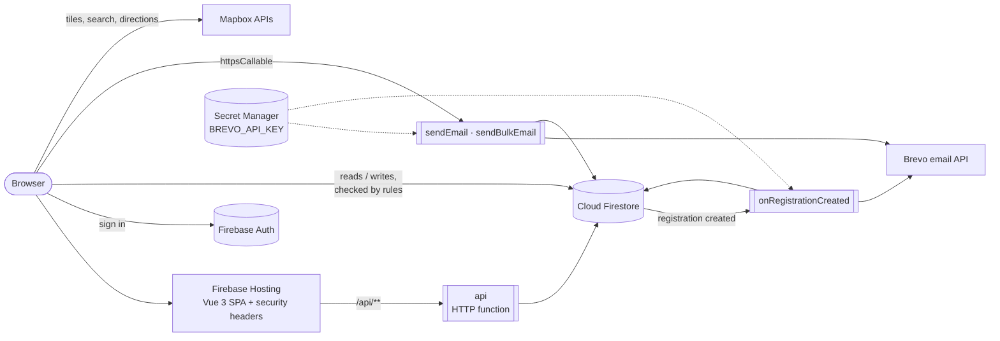

# GreenRoots Melbourne — FIT5032 Assignment 3

A Vue 3 single-page application for **GreenRoots Melbourne**, a fictional not-for-profit that runs
community tree planting, urban greening and biodiversity events across Greater Melbourne.
Assignment 3 turns the A1 front end into a full application backed by Firebase (Authentication,
Firestore, Cloud Functions and Hosting), with maps, charts, email and a public REST API.

| | |
|---|---|
| **Live site** | https://fit5032-1b795.web.app |
| **Public API** | https://fit5032-1b795.web.app/api/events |
| **Student** | Yunpeng Ke (35366397) |
| **Unit** | FIT5032 – Internet Applications Development |
| **Assessment** | A3 – Advanced Application Development (extends A1.2 / A1.3) |

The A1 code is kept unchanged in the repository's `Assignment-1/` folder.

**Test accounts.** The admin and volunteer test accounts are listed in the A3 submission report
rather than here, because this repository is public. Anyone can also create a volunteer account
on the Sign In page (email and password, or Google).

---

## Features by business requirement

| BR | What it does | Where |
|---|---|---|
| **D.1** Authentication | Firebase Auth: email/password sign-up and sign-in, Google sign-in, password reset. Roles (`volunteer`, `admin`) live in `users/{uid}`; sign-up can only create volunteers. Route guards wait for Firebase to restore the session. | `stores/authStore.js`, `views/LoginView.vue`, `router/index.js`, `firestore.rules` |
| **D.2** Email | Signed-in users send an email with an optional attachment (PDF/PNG/JPG/ICS, 2 MB) through a Cloud Function and Brevo. Volunteers are limited to 5 emails an hour. | `views/ComposeEmailView.vue`, `functions/index.js` (`sendEmail`) |
| **D.3** Interactive tables | Two PrimeVue tables with sorting, global search, a search box per column and 10 rows per page: public events, and admin-only volunteer registrations (120 Mockaroo rows plus real sign-ups). | `components/tables/EventsTable.vue`, `views/RegistrationsView.vue` |
| **D.4** Deployment | Firebase Hosting with SPA rewrites, cache headers and security headers; Firestore rules deployed alongside. | `firebase.json`, `firestore.rules` |
| **E.1** Cloud Functions | `sendEmail`, `sendBulkEmail` (callable), `onRegistrationCreated` (Firestore trigger: books a spot in a transaction and emails a confirmation with an `.ics` calendar file) and `api` (HTTP). Node 24, 2nd gen, `australia-southeast2`. | `functions/` |
| **E.2** Geolocation | Map of all events (Mapbox GL JS). Feature 1: search places or use your location, nearest events first (Haversine distance) with a radius filter. Feature 2: walking, cycling and driving routes with distance, time and CO₂ saved. | `views/MapView.vue`, `components/map/`, `utils/geo.js`, `utils/mapboxApi.js` |
| **E.3** Accessibility | WCAG 2.1 AA: see [Accessibility](#accessibility). | whole app |
| **E.4** Export | Export the filtered and sorted rows of either table to CSV (Excel-safe) or PDF. | `utils/export.js`, `components/tables/ExportButtons.vue` |
| **F.1** Admin Dashboard | Admin-only overview: users by role, registrations by status, places filled, events filling up and recent email activity, using Firestore count queries. | `views/AdminView.vue` (`/admin`) |
| **F.1** Interactive Charts | Public "Our Impact" page: filterable bar and line charts from Firestore, click a bar to drill down, with data tables as text alternatives. | `views/ImpactView.vue` (`/impact`) |
| **F.1** Bulk Email | Admins select volunteers in the registrations table and email them individually, with preview, confirmation and a result for every recipient. | `components/email/BulkEmailPanel.vue`, `functions/index.js` (`sendBulkEmail`) |
| **F.1** REST API | Read-only `GET /events`, `/events/{id}` and `/stats` for third parties, documented with a live "Try it" page. | `functions/api.js`, `views/DevelopersView.vue` (`/developers`) |

---

## Architecture



**Firestore collections:** `users`, `events`, `registrations`, `messages`, `ratings`, `emailLogs`.
Every collection has rules in `firestore.rules`; anything not listed is denied.

---

## Running locally

**Prerequisites:** Node.js `^22.18.0` or `>=24.12.0`, npm, and (for functions or emulators) the
Firebase CLI.

1. Create `.env.local` from `.env.example` with the Firebase web config and a Mapbox public token
   (the submitted zip already includes it).
2. Install and start:

   ```sh
   npm install
   npm run dev        # http://localhost:5173
   ```

   > Use port **5173** (or 5174). The Mapbox token only works from those local ports and the
   > live site, so the map will not load on any other port.

Other scripts:

```sh
npm run build          # production build into dist/
npm run preview        # serve the production build
npm run lint           # oxlint + ESLint
npm run emulators      # local Auth, Firestore and Functions emulators
npm run dev:emulator   # the app, pointed at the emulators
```

### Cloud Functions

```sh
cd functions && npm install
cp .env.example .env                          # set SENDER_EMAIL (a Brevo-verified sender)
firebase functions:secrets:set BREVO_API_KEY  # stored in Secret Manager, never in the code
```

### Deploying

```sh
npm run build
firebase deploy --only hosting,firestore:rules,firestore:indexes,functions:greenroots
```

The functions use their own codebase (`greenroots`) so deploying them never touches other
functions in the same Firebase project.

---

## REST API

Base URL: `https://fit5032-1b795.web.app/api` — read-only, JSON, CORS enabled, no key needed.
Full documentation and a live "Try it" button are at [`/developers`](https://fit5032-1b795.web.app/developers).

| Route | Description |
|---|---|
| `GET /events` | Events, soonest first. Optional `type`, `suburb`, `from` (YYYY-MM-DD) and `limit` (1–50, default 20). |
| `GET /events/{id}` | One event, or 404. |
| `GET /stats` | Totals and a breakdown by activity type. No personal information. |

```sh
curl "https://fit5032-1b795.web.app/api/events?type=Tree%20planting&limit=3"
curl "https://fit5032-1b795.web.app/api/stats"
```

Errors return `{ "error": { "status", "message" } }` with 400, 404, 405 or 500.

---

## Security

- **Firestore rules**: role checks for admins, users can only edit their own profile and never their
  role, field allow-lists and length limits, server timestamps, default deny.
- **Secrets**: the Brevo key is in Secret Manager; the browser only has public config (Firebase web
  config and a Mapbox token restricted to this site's URLs).
- **Functions**: input validation, attachment type checked by file signature (not just the name),
  header-injection checks on subjects, rate limiting, admin checks on the server.
- **Bulk email** takes registration IDs, never raw addresses, so it cannot be used to email anyone
  outside the site's registrations.
- **Hosting headers**: a strict Content Security Policy (no `unsafe-inline` or `unsafe-eval`
  scripts), `frame-ancestors 'none'`, `X-Frame-Options`, `X-Content-Type-Options`,
  `Referrer-Policy`, `Permissions-Policy` (location only for this site) and HSTS.

---

## Accessibility

Built and audited against **WCAG 2.1 AA** with axe-core, Lighthouse, accessibilitychecker.org,
keyboard-only testing and a screen reader.

- Skip link, landmarks, one `h1` per page and a logical heading order.
- Every page sets its own title, and focus moves to the new page's heading after navigation.
- Visible focus ring everywhere; everything works with the keyboard (map markers, place search
  combobox, table sorting, dialogs).
- Text and controls meet 4.5:1 contrast; layouts reflow at 320px and 200% zoom.
- Form errors are linked to their fields (`aria-describedby`, `aria-invalid`) and focus moves to
  the first error on submit.
- The map has an equivalent keyboard-accessible event list; each chart has a text summary and a
  data table.

Lighthouse (live site): Accessibility, Best Practices and SEO 100 on every page tested.

---

## Project structure

```
src/
├── components/
│   ├── common/        EventCard, StarRating
│   ├── email/         BulkEmailPanel
│   ├── layout/        NavBar, FooterBar
│   ├── map/           PlaceSearch, TripPanel
│   └── tables/        EventsTable, ExportButtons
├── composables/       useFormValidation, useGeolocation
├── firebase/init.js   Firebase app, Auth, Firestore, Functions (+ emulator switch)
├── router/index.js    Routes, titles, auth and admin guards
├── stores/            authStore, eventStore, ratingStore (Pinia)
├── utils/             attachment, export, geo, mapboxApi, security
└── views/             One component per route
functions/             Cloud Functions (index.js, api.js, calendar.js)
seed/                  Event data, Mockaroo registrations and the Firestore import script
firestore.rules        Security rules
firebase.json          Hosting, headers, rewrites, functions and emulator config
```

---

## Libraries and data

Vue 3, Vue Router, Pinia, Vite · Bootstrap 5 and Bootstrap Icons · Firebase JS SDK,
firebase-functions and firebase-admin · PrimeVue 4 with the Aura theme (MIT) · Chart.js and
vue-chartjs (MIT) · jsPDF and jspdf-autotable (MIT) · Mapbox GL JS (Mapbox Terms of Service),
Mapbox Search Box and Directions APIs · Brevo transactional email API.

The organisation, events, articles and team are fictional. Volunteer registrations were generated
with [Mockaroo](https://www.mockaroo.com/) and are marked as sample data; they are never emailed.
The CO₂ figure uses the Australian Government Green Vehicle Guide average for new light vehicles
(181 g/km).
